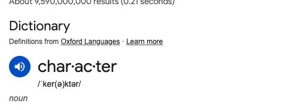

# 

**Learning objective:** By the end of this lesson, students will be able to distinguish between args and kwargs and better know when to use them.

## Keyword arguments - kwargs

tktk - Hunter, in the notion content there is a video here of Ben showing how to prounouce kwargs. Can we get a visual of that here? I like a dictionary prounouncing things. I took a screen shot of what I mean with the word character


`kwargs` stands for ***keyword arguments***. They are arguments that have a name. You can provide as many as you like to a function.

## Python's `**` parameter specifier (`**kwargs`)

If you'd like to access a varying number of keyword arguments, use `**kwargs` at the ***end of the parameter list***. Just like with `args`, `kwargs` could technically be anything but is named `kwargs` by convention - what matters is the `**`.

Let's define and call a function that uses `**kwargs`:

```python
def make_employee(role, **kwargs):
    print(kwargs)
    # prints: {'first': 'Sam', 'middle': 'Harris', 'last': 'Altman'}
    print(type(kwargs))
    # prints: <class 'dict'>
    # kwargs is a dictionary - you can use it anywhere you'd use one:
    employee = {"role": role, "name": kwargs}
    return employee

print(make_employee("CEO", first="Sam", middle="Harris", last="Altman"))
# prints: {
#     'role': 'CEO',
#     'name': {'first': 'Sam', 'middle': 'Harris', 'last': 'Altman'}
# }
```

`**kwargs` should only be added at the end of the parameter list.

As you can see above, in a function, kwargs can be accessed by its name - `kwargs`. `kwargs` is a dictionary, meaning you can treat it as such. For example, you could iterate through it using the `values()` method:

```python
def make_employee(role, **kwargs):
    username = ""
    for name in kwargs.values():
        username += name

    employee = {"role": role, "username": username}
    return employee

print(make_employee("CEO", first="Sam", middle="Harris", last="Altman"))
```

### Combining argument types

Required positional, optional positional (`*args`), and keyword (`**kwargs`) arguments can all be used simultaneously.

But note that order is important! Check out this example:

```python
def arg_demo(pos1, pos2, *args, **kwargs):
    print(f'Positional params: {pos1}, {pos2}')
    print('*args:')
    for arg in args:
        print(' ', arg)
    print('**kwargs:')
    for keyword, value in kwargs.items():
        print(f'  {keyword}: {value}')

arg_demo('A', 'B', 1, 2, 3, color='purple', shape='circle')
```

Which results in this output:

```plaintext
Positional params: A, B
*args:
  1
  2
  3
**kwargs:
  color: purple
  shape: circle
```
